# WattWise: solar splits that fit

WattWise is software that tells Sime Darby Property (SDP) how to share its residents' rooftop solar between the buildings that buy it, four months ahead. It is Team Promax's entry to the Sime Darby Hackathon 2026, "Township of Tomorrow".

The pitch deck is in this folder: [WattWise Pitch Deck.pdf](WattWise%20Pitch%20Deck.pdf).

**Live demo:** [wattwise-promax.netlify.app](https://wattwise-promax.netlify.app) (operator app and testing suite, demo data only).

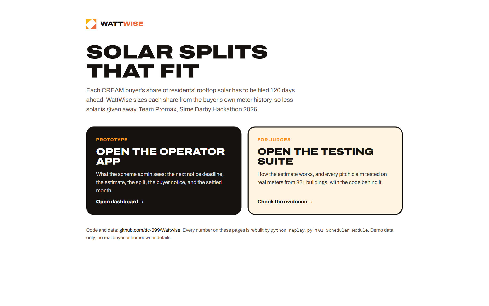

## The problem

Under Malaysia's Community Renewable Energy Aggregation Mechanism (CREAM), the aggregator (SDP at Elmina) pools solar from home roofs and supplies nearby buyers. Three rules in the Energy Commission's Guidelines (GP/ST/No.55/2025) make fixed splits costly:

- **120 days' notice.** Each buyer's percentage share must be filed in writing 120 days before it takes effect, and only changes on the 1st of a month (clause 9.10(e)). The share is set before the real demand is known.
- **Over-allocation is lost.** Solar sent to a buyer beyond what it uses is "free energy" to the grid and earns nothing (9.9), while the 9 sen/kWh community access charge still applies to it (13.2).
- **Held-back solar can be sold.** Solar the aggregator keeps back can be sold through NEDA at 8 sen/kWh, with no access charge (9.7, 13.2). The Commission can change that rate.

Replayed on real meter readings from 821 buildings, a fixed yearly split gives away a median 6.05% of the year's solar across 407 two-buyer schemes.

## What WattWise does

1. **Read** each buyer's monthly meter history.
2. **Estimate** each buyer's use for a month that has not happened yet: the same month last year, adjusted by the latest trend. The estimator only sees data that existed before the release date.
3. **Allocate** each buyer its estimate as a share of the expected solar (scaled down if the estimates add up to more), minus a 2% hold-back. What is not allocated is sold through NEDA.
4. **File.** Each month is stamped with its notice date, 120 days before it starts. WattWise suggests, the scheme admin approves, SDP files. The tool never sends anything on its own.
5. **Settle.** Once TNB bills the month on real meters, compare what was allocated with what was used.

## Results

One command rebuilds every number below, on the deck and on both web pages: `python replay.py` in `02 Scheduler Module` (standard Python, about a second; `--check` confirms the committed results match). Judges without Python can press **Re-run the replay** in Appendix A of the testing suite: the same rules, ported line for line to `03 User Interface/replay.js`, run in the browser on the same inputs and check every quoted figure. Inputs are public and committed: real monthly electricity from the Building Data Genome Project 2 and rooftop solar at Elmina from PVGIS. How each figure is derived: [docs/evidence-provenance.md](../docs/evidence-provenance.md).

| Result | Figure | Basis |
|---|---|---|
| Median solar given away, 407 two-buyer schemes | fixed 6.05%, copy-last-year 1.95%, WattWise 1.34% | 821 real buildings, 2016-2017, replayed with CREAM's 120-day notice |
| Humid Texas site (42 schemes) | fixed 3.83%, WattWise 0.85% | the most Malaysia-like climate with complete data |
| Gives away less than a fixed split | 99.8% of two-buyer schemes (98.5% one-buyer) | measured |
| Gives away less than copy-last-year | 83.3% of two-buyer schemes (77.2% one-buyer) | measured |
| Scheme built 1.2x larger | WattWise gives away 2.17%, below a fixed split's 6.05% today; no worse in 94.6% of schemes | measured |
| Estimate error | median month 7.9%; a buyer's worst month 22.4% (median) | measured |
| Elmina size (9,409 MWh a year, 6,840 kWp, 1,368 roofs) | 443 MWh a year kept from being given away; paid-for share 94.0% to 98.7% | benchmark medians applied to the assumed size |
| Extra scheme income, Elmina size | RM24,600 (at 30 sen) to RM76,000 (at 15 sen) a year; RM18 to RM56 per roof | modelled; the real CREAM price is private |
| Floor case: Innovation Park alone | RM6,000 to RM21,800 a year | modelled |

Honest limits: the extra income shrinks as the CREAM price rises, and above about 20 sen copying last year earns slightly more than WattWise, because the hold-back sells at 8 sen some energy a buyer would have used. No Elmina meter data is public, so Elmina figures are benchmark medians at Elmina's assumed size; Lakeside Mall as a second buyer is an assumption.

## The prototype (operator app)

`03 User Interface/admin.html` is the app the scheme admin would use. It is a static page; open it from a local web server (`START-DASHBOARD.bat`, or `python -m http.server` in `03 User Interface`). Only the buyers' meter-readings CSV is read today.

| | |
|---|---|
| 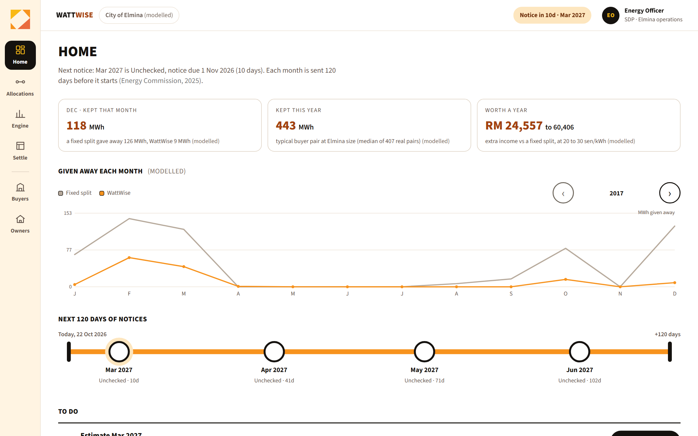 **Home.** What the admin has to do next, and the notice deadline. | 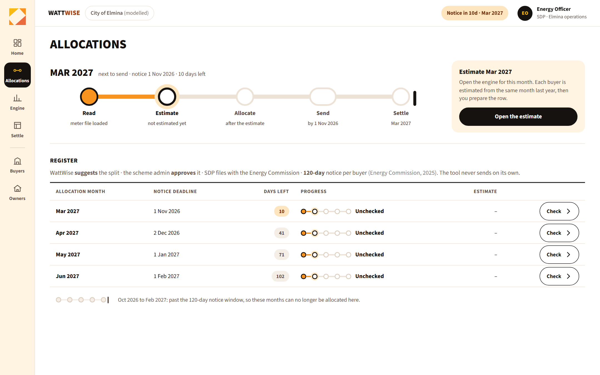 **Allocations.** Each month on a five-step line, with its 120-day notice deadline. |
| 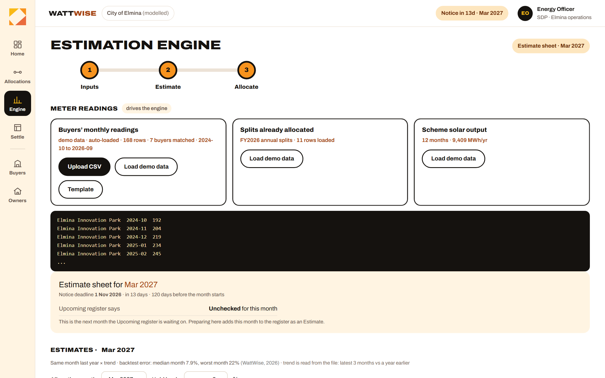 **Engine.** Same month last year times trend, per buyer, with the hold-back. | 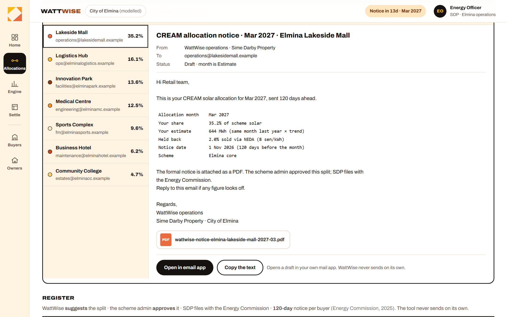 **Notice preview.** The email and PDF each buyer would receive, shown before anything is sent. |
| 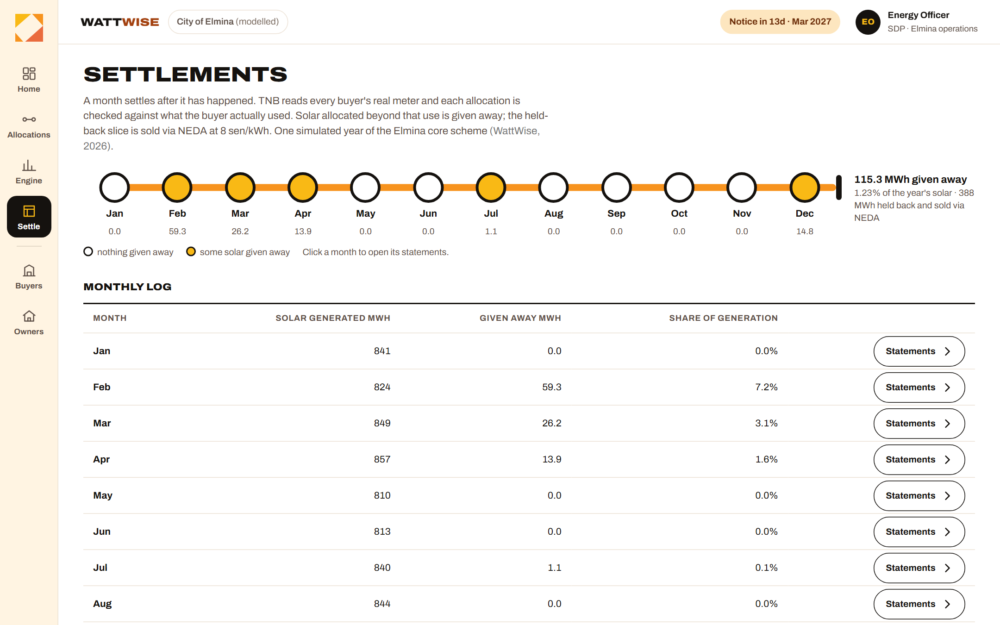 **Settlements.** A month allocated against what was used. | 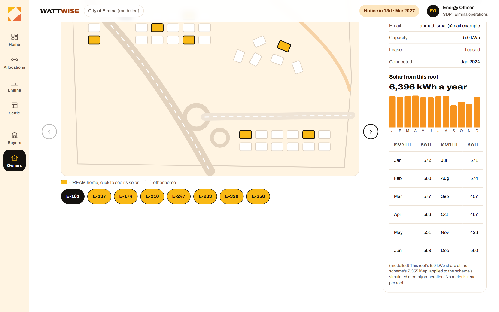 **Homes.** CREAM homes on the neighbourhood plan; click one to see its modelled solar. |

## The testing suite (for judges)

`03 User Interface/tests.html` explains how the estimate works and tests each claim in the deck, one appendix per claim, with the raw numbers and the code behind them.

| | |
|---|---|
| 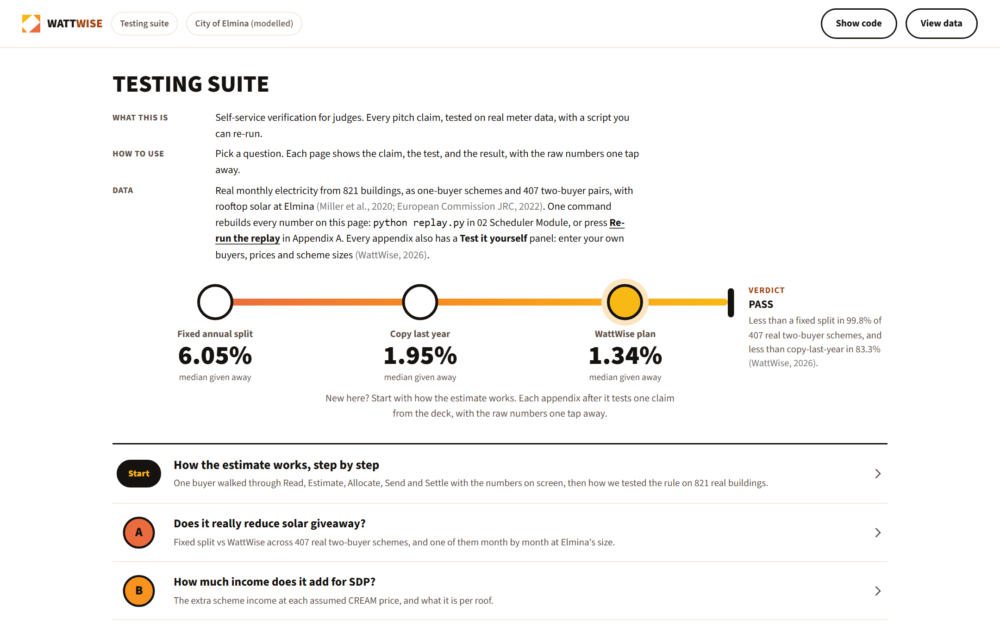 **Start here.** The headline result and the four appendices. | 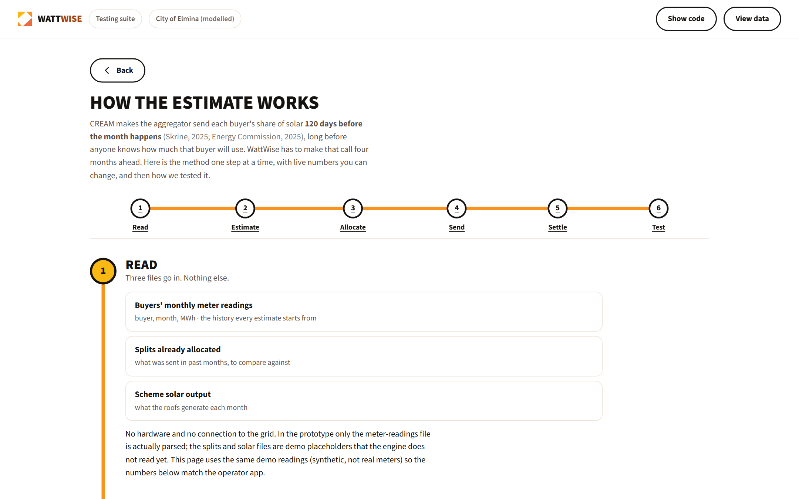 **How the estimate works.** A live worked example: estimate, share, hold-back, settle. |
| 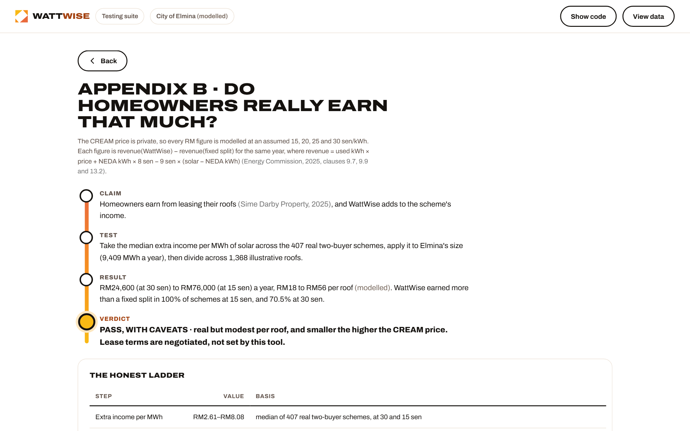 **Appendix B.** The money, step by step, at the assumed price band. | 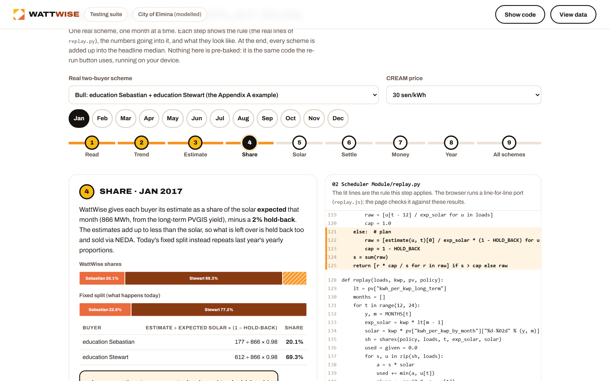 **Watch the replay run.** Step one real scheme through the code month by month: the lit lines of `replay.py`, the numbers going in, and a graph of each step. |
| 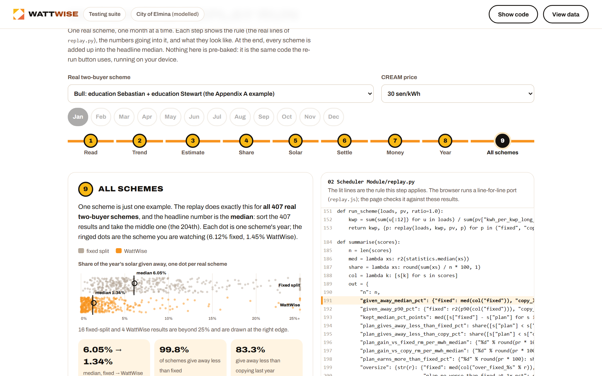 **All schemes.** The last step adds up every real scheme into the headline median. | |

Appendix A tests fixed vs WattWise across the 407 two-buyer schemes (with one shown month by month at Elmina size), B the income, C whether a scheme can be built 20% larger, and D dynamic splitting against fixed and copy-last-year across the 821 buildings.

## Repository layout

- `00 Documents/`: this README, the pitch deck, screenshots, and the documentation log
- `01 Prediction Module/`, `04 Physical Kit/`: earlier building-side experiments, not part of WattWise
- `02 Scheduler Module/`: `replay.py` (every number), `build_inputs.py`, the committed inputs in `data/` and the results in `results/`
- `03 User Interface/`: `admin.html` (prototype), `tests.html` (testing suite), `PRODUCT.md` and `DESIGN.md`
- `docs/`: `evidence-provenance.md`, the red-team report and the action plan

## Status and limits

A working prototype and tests on real past data. It has not been trialled at Elmina, and SDP has not approved a pilot. The proposed pilot is a no-cost, three-month shadow run: SDP shares three files, WattWise suggests splits, SDP still files.

## References

Energy Commission (2025) *Guidelines for Community Renewable Energy Aggregation Mechanism (CREAM)*, GP/ST/No.55/2025. Miller, C. et al. (2020) 'The Building Data Genome Project 2', *Scientific Data*, 7, 368. Skrine (2025) *Energy Commission issues guidelines for Malaysia's CREAM*. The full list is on the last slide of the deck.
